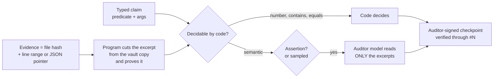

<div align="center">

# eilikrineia

**Un registro público de compromisos entre una persona y los agentes de IA que trabajan para ella.**

[](https://doi.org/10.5281/zenodo.23752630)
[](LICENSE)
[](LICENSES/CC-BY-4.0.txt)
[](https://www.python.org/)
[-brightgreen.svg)](tests)
[](eilikrineia.py)

[English](README.md) · [Português](README.pt-BR.md) · [Español](README.es.md) · [Italiano](README.it.md) · [עברית](README.he.md)

</div>

> [!NOTE]
> Traducción de [`README.md`](README.md) en el commit `bc039be`. En caso de discrepancia, prevalece el texto en inglés.

> [!IMPORTANT]
> Un agente que dice "hecho", "probado" o "funciona" consigna primero aquí esa frase, con evidencia. Lo que el código
> puede comprobar lo comprueba el código. Lo que no puede lo lee un modelo de otro proveedor, que solo ve fragmentos
> breves que el programa recortó y demostró, nunca archivos completos. El dueño firma la raíz, cada cambio de clave y
> cada cambio en el código del auditor. Nada se edita; cambiar de posición es una corrección visible.

> [!WARNING]
> Estos mecanismos se sostienen solo mientras el agente no pueda acceder a la clave del dueño, a la cuenta del auditor
> ni al archivo testigo (ver [Qué está garantizado y qué no](#qué-está-garantizado-y-qué-no)). La versión 1.0.0 tiene
> un defecto en la raíz de confianza: no use su verificador ni su tarea de auditor
> ([`.github/SECURITY.md`](.github/SECURITY.md)); use la 1.0.1 o posterior.

## La palabra

**εἰλικρίνεια** (*eilikríneia*) es la palabra griega para sinceridad, pureza de intención, lo que no tiene mezcla. Los
léxicos la leen tradicionalmente como **εἵλη** (*heílē*, el rayo del sol) + **κρίνω** (*krínō*, juzgar): *probado a la
luz del sol y hallado sin defecto*. La derivación es probable, no está establecida; Trench lee la palabra menos como
"transparente" que como **cribado, purgado, sin mezcla**. Este proyecto conserva ambas imágenes, y con ellas la
incertidumbre: la luz es la exposición pública; la criba separa lo que tiene respaldo de lo que no lo tiene.

Existe una historia famosa según la cual el latín *sincerus* significa *sine cera*, "sin cera", por los alfareros que
ocultaban las grietas con cera. Es una etimología popular que los diccionarios rechazan. La contamos a propósito: un
registro de sinceridad que se abriera con una etimología bonita y falsa sería su propia primera violación.

El *Fedón* de Platón (65e–66a) describe la búsqueda de la verdad "con el pensamiento puro, él mismo por sí mismo"
(*αὐτῇ καθ᾽ αὑτὴν εἰλικρινεῖ τῇ διανοίᾳ*); Pablo usa *eilikríneia* para una conducta que puede mostrarse y examinarse
(2 Corintios 1:12; 2:17). La luz que expone y el examen sin mezcla se convierten en mecanismo:

| Idea | Mecanismo |
|---|---|
| Examinado a la luz del sol | Repositorio público y sellos de tiempo en Bitcoin: cualquiera verifica, sin tener que preguntar |
| Sin mezcla | SHA-256: cambiar una coma cambia todo el hash |
| Lo dicho no puede sustituirse | Cadena: cada entrada lleva el hash anterior |
| Cambiar de opinión a la vista | Una corrección es una entrada nueva que apunta a la anterior, que permanece |
| El juez no es quien afirma | Un auditor de otro proveedor, en otra cuenta del sistema operativo, firma el veredicto |
| Pureza sin exposición | Compromiso con sal: el hash es público, el texto permanece privado hasta que se revela |

## Qué aporta

1. **Confianza con raíz en el dueño.** La primera entrada es la génesis del dueño, firmada con una clave protegida
   por frase de contraseña. La lista de claves y el código del auditor solo cambian con una entrada firmada por el
   dueño; el verificador rechaza cualquier otra cosa.
2. **Auditoría que no lo lee todo.** Las afirmaciones tienen tipo. Los conteos, las coincidencias y los valores los
   decide el código. El modelo auditor lee solo fragmentos de 2000 caracteres como máximo, recortados de copias
   inmutables de la bóveda con una prueba de posición y de hash; los archivos grandes se adjuntan por hash y nunca se
   envían a un modelo. Las aserciones dirigidas al dueño se auditan siempre; las mediciones automatizadas se auditan
   por muestreo, con una semilla tomada de un head posterior. Cada ejecución del auditor firma un punto de control que
   lleva todos sus veredictos, audita solo lo que vino después del anterior, y un registro inactivo no agrega nada.
3. **Sin reescritura silenciosa.** Un testigo en la cuenta separada del auditor registra el hash de cada entrada cada
   vez que se ejecuta la tarea del auditor (cada hora, y no mientras la máquina duerme); una entrada ya vista que
   cambie o desaparezca genera una alarma firmada. El historial publicado
   está protegido por la protección de ramas del remoto, Software Heritage y OpenTimestamps.



## Inicio rápido

Verifique el registro público (sin datos privados, sin necesidad de claves; Python 3.11+ y OpenSSH 8.9+):

```bash
git clone https://github.com/ulissesflores/eilikrineia
cd eilikrineia
python3 eilikrineia.py verify
```

Salida esperada (los conteos crecen a medida que crece el registro):

```text
{
  "ok": true,
  "entries": <N>,
  "head": "<64 hex>",
  "problems": [],
  "trust_root": "owner genesis"
}
```

Ejecute las pruebas:

```bash
python3 -m unittest discover -s tests -v
```

Inicie su propio registro:

```bash
python3 eilikrineia.py --root my-ledger init                          # agent and auditor keys
ssh-keygen -t ed25519 -f my-ledger/private/keys/owner                 # YOUR key, with a passphrase
python3 eilikrineia.py --root my-ledger init                          # publishes your public key
python3 eilikrineia.py --root my-ledger genesis                       # you sign the root
python3 eilikrineia.py --root my-ledger record --role agent --type opinion --text "First note."
```

Vigílelo y audítelo. Ambos se ejecutan desde la cuenta del sistema operativo propia del auditor (ver
[`scripts/`](scripts)); el archivo testigo debe poder ser escrito solo por esa cuenta, porque el código no puede
imponer quién lo escribe:

```bash
# witness: remember every entry hash; an entry already seen that changed or vanished becomes a signed alarm
EILIKRINEIA_WITNESS=/path/only/the/auditor/writes/witness.json python3 eilikrineia.py --root my-ledger witness

# audit: code decides number/contains/equals claims; a model from another vendor reads only the excerpts of
# semantic ones, and one signed checkpoint carries every verdict of the run
python3 eilikrineia.py --root my-ledger audit --auditor grok          # or --auditor codex
```

Consulte [`PROTOCOL.md`](PROTOCOL.md) para los roles, los tipos, las afirmaciones y las reglas que sigue un agente.

## Qué está garantizado y qué no

> [!CAUTION]
> **Límite de confianza.** Todo lo que sigue supone que el agente no puede acceder a la clave privada del dueño ni a su
> frase de contraseña, a la cuenta del sistema operativo del auditor ni al archivo testigo. Un agente que pueda
> convertirse en root en la máquina (por ejemplo, mediante una contraseña de administrador guardada donde su cuenta
> pueda leerla) puede anular cada uno de los puntos. Ejecute los agentes como usuario estándar sin derechos de
> administrador, o lea el registro como una contabilidad llevada por un agente cooperativo.
> El [Protocolo 2](PROTOCOL.md#protocol-2-draft-not-implemented) está diseñado para una máquina de agente hostil; no
> está implementado.

**Comprobado por código, dentro de ese límite.** Las pruebas ([`tests/`](tests)) ejercitan cada comprobación en una
máquina y una cuenta; ninguna cruza el límite entre cuentas.
- Cada entrada publicada está enlazada con la anterior: cambiar o eliminar una rompe todos los hashes posteriores.
- Qué clave firmó cada entrada, frente a la lista de claves que el dueño había firmado cuando se escribió la entrada.
- La lista de claves y el código fijado del auditor son los que el dueño firmó por última vez.
- Cada fragmento que leyó un auditor es el registrado, recortado del archivo cuyo hash quedó comprometido.
- Una entrada ya registrada por el testigo que cambie o desaparezca genera una alarma firmada.

**No garantizado:**
- que una declaración sea verdadera. Es rastreable, impugnable y costosa de sostener si es falsa;
- que la evidencia provenga de ejecutar algo: una entrada `measured` prueba lo que dice un archivo, y el agente puede
  haber escrito el archivo;
- cuándo se escribió una entrada: `time` lo declara quien escribe, y OpenTimestamps da solo una cota superior, una vez
  que se sella un head posterior;
- qué modelo produjo una frase: una firma prueba una clave, no una mente;
- lo que nunca se registró. La omisión no tiene un cerrojo mecánico; el protocolo la convierte en un incumplimiento;
- entradas reescritas entre dos ejecuciones del testigo: el intervalo es de hasta una hora, más mientras la máquina
  duerme.

**Congelados, no re-ejecutables:** los registros en [`history/`](history). `v0` (solo claves de agente) y `v1`
(primera génesis del dueño) se registraron en portugués con el esquema de aquella época; sus nombres de campo forman
parte de sus hashes y se mantienen tal como estaban. Verifíquelos con el script congelado:

```bash
python3 history/eilikrineia_v1.py --raiz history/v1 verificar
python3 history/eilikrineia_v1.py --raiz history/v0 verificar
```

## Integridad

La cadena es su propia procedencia: no hay un segundo sello. `python3 eilikrineia.py verify` recalcula cada hash,
enlace y firma a partir de los archivos públicos. Cada publicación sella en el tiempo el head con
[OpenTimestamps](https://opentimestamps.org) (`stamps/*.ots`, actualizados una vez confirmados en un bloque de
Bitcoin), y el repositorio está archivado en [Software Heritage](https://archive.softwareheritage.org).

## Estructura

```text
eilikrineia.py      the whole tool: record, verify, audit, witness, genesis, rotate, stamp, publish
PROTOCOL.md         rules any agent follows to write here
chain/              one public entry per file: hashes, links, signatures
keys/               allowed_signers: the public keys of owner, agent and auditor
stamps/             OpenTimestamps proofs of the head
history/            earlier ledgers (v0, v1) and the frozen script that verifies them
scripts/            auditor job and macOS installer (separate account, pinned code, deploy key)
tests/              one test per guarantee above
private/            never published: texts, salts, gzip evidence vault, private keys, audit replies
```

## Autor

**Carlos Ulisses Flores** — Codex Hash Research Laboratory

[](https://orcid.org/0000-0002-6034-7765)
[](https://ulissesflores.com)
[](http://lattes.cnpq.br/6905246706890561)

## Cita

Cada versión se archiva en Zenodo con su propio DOI. El DOI de concepto [10.5281/zenodo.23752630](https://doi.org/10.5281/zenodo.23752630) siempre resuelve a la versión más reciente; la versión 1.0.1 es [10.5281/zenodo.23820676](https://doi.org/10.5281/zenodo.23820676) y la versión 1.0.0 es [10.5281/zenodo.23752631](https://doi.org/10.5281/zenodo.23752631). Cite con [`CITATION.cff`](CITATION.cff) o:

```bibtex
@software{flores2026eilikrineia,
  author = {Flores, Carlos Ulisses},
  orcid  = {https://orcid.org/0000-0002-6034-7765},
  title  = {eilikrineia: a public commitment ledger between a person and the AI agents working for them},
  year   = {2026},
  version = {1.0.1},
  doi    = {10.5281/zenodo.23752630},
  url    = {https://github.com/ulissesflores/eilikrineia}
}
```

## Licencia

Doble licencia: el código fuente bajo **Apache-2.0** ([`LICENSE`](LICENSE)); la documentación bajo **CC BY 4.0**
([`LICENSES/CC-BY-4.0.txt`](LICENSES/CC-BY-4.0.txt)). Ver [`NOTICE`](NOTICE).

## Referencias de respaldo

- Léxicos sobre εἰλικρίνεια / εἰλικρινής: [Bible Hub 1505](https://biblehub.com/greek/1505.htm),
  [Bible Hub 1506](https://biblehub.com/greek/1506.htm). R. C. Trench, *Synonyms of the New Testament*, sobre
  εἰλικρινής: [texto](https://modernliteralversion.org/bibles/bs2/G5625up/Trench-85.htm).
- *Sine cera* como etimología popular: [Etymonline](https://www.etymonline.com/word/sincere),
  [Grammarphobia](https://grammarphobia.com/blog/2012/03/sincere.html).
- Platón, *Fedón*, texto griego y traducción de Fowler: [Perseus](https://cts.perseids.org/read/greekLit/tlg0059/tlg004/perseus-eng2/65-66).
- OpenTimestamps: [opentimestamps.org](https://opentimestamps.org/).
