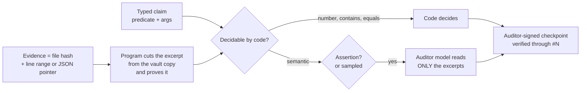

<div align="center">

# eilikrineia

**פנקס התחייבויות ציבורי בין אדם לבין סוכני ה-AI שעובדים עבורו.**

[](https://doi.org/10.5281/zenodo.23752630)
[](LICENSE)
[](LICENSES/CC-BY-4.0.txt)
[](https://www.python.org/)
[-brightgreen.svg)](tests)
[](eilikrineia.py)

[English](README.md) · [Português](README.pt-BR.md) · [Español](README.es.md) · [Italiano](README.it.md) · [עברית](README.he.md)

</div>

> [!NOTE]
> תרגום של [README.md](README.md) ב-commit `bc039be`. אם יש ביניהם הבדל, הטקסט האנגלי גובר. העברית היא תרגום אוטומטי,
> ללא בדיקה אנושית של הצגת הטקסט מימין לשמאל.

> [!IMPORTANT]
> סוכן שאומר "בוצע", "נבדק" או "זה עובד" רושם כאן קודם את המשפט הזה כהתחייבות, עם ראיות. מה שקוד יכול לבדוק נבדק
> בקוד. מה שקוד אינו יכול לבדוק נקרא על ידי מודל של ספק אחר, שרואה רק קטעים קצרים שהתוכנה חתכה והוכיחה, ולעולם לא
> קבצים שלמים. הבעלים חותם על השורש, על כל שינוי מפתח ועל כל שינוי בקוד של המבקר. שום דבר אינו נערך; שינוי עמדה הוא
> תיקון גלוי.

> [!WARNING]
> מנגנונים אלה תקפים רק כל עוד הסוכן אינו יכול להגיע למפתח של הבעלים, לחשבון של המבקר או לקובץ העד
> (ראו [מה מובטח ומה לא](#מה-מובטח-ומה-לא)). בגרסה 1.0.0 יש פגם בשורש האמון: אל תשתמשו במאמת שלה או במשימת המבקר
> שלה ([`.github/SECURITY.md`](.github/SECURITY.md)); השתמשו ב-1.0.1 ומעלה.

## המילה

**εἰλικρίνεια** (*eilikríneia*) היא המילה היוונית לכנות, לטוהר כוונה, למה שאין בו תערובת. המילונים קוראים אותה
באופן מסורתי כ-**εἵλη** (*heílē*, קרן השמש) + **κρίνω** (*krínō*, לשפוט): *נבחן מול אור השמש ונמצא ללא פגם*.
הגזירה סבירה, אך אינה מוכרעת; Trench קורא את המילה פחות כ"שקוף" ויותר כ-**מנופה, מטוהר, בלתי מעורב**. הפרויקט הזה
שומר על שני הדימויים, ועל אי-הוודאות יחד איתם: האור הוא החשיפה הציבורית; הנפה מפרידה בין מה שנתמך למה שלא.

יש סיפור מפורסם שלפיו המילה הלטינית *sincerus* פירושה *sine cera*, "בלי שעווה", על שם קדרים שהסתירו סדקים
בשעווה. זוהי אטימולוגיה עממית שהמילונים דוחים. אנחנו מספרים אותה בכוונה: פנקס של כנות שהיה נפתח באטימולוגיה
יפה ושקרית היה ההפרה הראשונה של עצמו.

*פיידון* של אפלטון (65e–66a) מתאר חיפוש אחר האמת "במחשבה טהורה, היא כשלעצמה"
(*αὐτῇ καθ᾽ αὑτὴν εἰλικρινεῖ τῇ διανοίᾳ*); פאולוס משתמש ב-*eilikríneia* להתנהלות שאפשר להראות ולבחון
(האיגרת השנייה אל הקורינתים 1:12; 2:17). האור החושף והבחינה ללא תערובת הופכים למנגנון:

| רעיון | מנגנון |
|---|---|
| נבחן באור השמש | מאגר ציבורי וחותמות זמן של Bitcoin: כל אחד מאמת, בלי לבקש רשות |
| ללא תערובת | SHA-256: שינוי של פסיק אחד משנה את ה-hash כולו |
| מה שנאמר אינו ניתן להחלפה | שרשרת: כל רשומה נושאת את ה-hash של הרשומה הקודמת |
| לשנות דעה בגלוי | תיקון הוא רשומה חדשה שמצביעה על הישנה, והישנה נשארת |
| השופט אינו מי שטוען | מבקר מספק אחר, בחשבון אחר של מערכת ההפעלה, חותם על פסק הדין |
| טוהר ללא חשיפה | התחייבות עם salt: ה-hash ציבורי, הטקסט נשאר פרטי עד שהוא נחשף |

## מה תרומתו

1. **אמון שמעוגן בבעלים.** הרשומה הראשונה היא ה-genesis של הבעלים, חתומה במפתח המוגן בסיסמה (passphrase).
   רשימת המפתחות והקוד של המבקר משתנים רק ברשומה שהבעלים חתם עליה; המאמת דוחה כל דבר אחר.
2. **ביקורת שאינה קוראת הכול.** לכל טענה יש סוג מוגדר. ספירות, התאמות וערכים מוכרעים בקוד. מודל המבקר קורא רק
   קטעים של 2,000 תווים לכל היותר, שנחתכו מעותקים בלתי ניתנים לשינוי בכספת, עם הוכחה של מיקום ושל hash; קבצים
   גדולים מצורפים לפי hash ולעולם אינם נשלחים למודל. הצהרות בפני הבעלים נבדקות תמיד; מדידות אוטומטיות נדגמות
   עם seed שנלקח מ-head מאוחר יותר. כל הרצה של המבקר חותמת על checkpoint אחד שנושא את כל פסקי הדין שלה, בודקת רק
   את מה שבא אחרי ה-checkpoint הקודם, ופנקס שאין בו פעילות אינו מוסיף דבר.
3. **אין שכתוב שקט.** עד בחשבון הנפרד של המבקר רושם את ה-hash של כל רשומה בכל פעם שמשימת המבקר רצה (מדי שעה,
   ולא בזמן שהמחשב במצב שינה); רשומה שכבר נראתה ומשתנה או נעלמת מעוררת התראה חתומה. ההיסטוריה שפורסמה
   מוגנת על ידי הגנת הענפים (branch protection) של המאגר המרוחק, Software Heritage ו-OpenTimestamps.



## התחלה מהירה

אמתו את הפנקס הציבורי (בלי נתונים פרטיים, בלי צורך במפתחות; Python 3.11+ ו-OpenSSH 8.9+):

```bash
git clone https://github.com/ulissesflores/eilikrineia
cd eilikrineia
python3 eilikrineia.py verify
```

הפלט הצפוי (המספרים גדלים ככל שהפנקס גדל):

```text
{
  "ok": true,
  "entries": <N>,
  "head": "<64 hex>",
  "problems": [],
  "trust_root": "owner genesis"
}
```

הריצו את הבדיקות:

```bash
python3 -m unittest discover -s tests -v
```

פתחו פנקס משלכם:

```bash
python3 eilikrineia.py --root my-ledger init                          # agent and auditor keys
ssh-keygen -t ed25519 -f my-ledger/private/keys/owner                 # YOUR key, with a passphrase
python3 eilikrineia.py --root my-ledger init                          # publishes your public key
python3 eilikrineia.py --root my-ledger genesis                       # you sign the root
python3 eilikrineia.py --root my-ledger record --role agent --type opinion --text "First note."
```

השגיחו עליו ובקרו אותו. שתי הפעולות רצות מחשבון מערכת ההפעלה של המבקר עצמו (ראו [`scripts/`](scripts)); קובץ העד
חייב להיות ניתן לכתיבה רק על ידי החשבון הזה, כי הקוד אינו יכול לאכוף מי כותב אליו:

```bash
# witness: remember every entry hash; an entry already seen that changed or vanished becomes a signed alarm
EILIKRINEIA_WITNESS=/path/only/the/auditor/writes/witness.json python3 eilikrineia.py --root my-ledger witness

# audit: code decides number/contains/equals claims; a model from another vendor reads only the excerpts of
# semantic ones, and one signed checkpoint carries every verdict of the run
python3 eilikrineia.py --root my-ledger audit --auditor grok          # or --auditor codex
```

ראו את [`PROTOCOL.md`](PROTOCOL.md) לתפקידים, לסוגים, לטענות ולכללים שסוכן פועל לפיהם.

## מה מובטח ומה לא

> [!CAUTION]
> **גבול האמון.** כל מה שלהלן מניח שהסוכן אינו יכול להגיע למפתח הפרטי של הבעלים או לסיסמה שלו, לחשבון מערכת
> ההפעלה של המבקר, או לקובץ העד. סוכן שיכול להפוך ל-root במחשב (למשל, באמצעות סיסמת מנהל שמאוחסנת במקום שהחשבון
> שלו יכול לקרוא) יכול לעקוף כל אחד מהפריטים. הריצו סוכנים כמשתמש רגיל ללא הרשאות מנהל, או קראו את הפנקס כהנהלת
> חשבונות שמנהל סוכן משתף פעולה.
> [פרוטוקול 2](PROTOCOL.md#protocol-2-draft-not-implemented) מתוכנן למחשב סוכן עוין; הוא אינו ממומש.

**נבדק בקוד, בתוך הגבול הזה.** הבדיקות ([`tests/`](tests)) מפעילות כל בדיקה על מחשב אחד ובחשבון אחד; אף אחת מהן
אינה חוצה את הגבול בין חשבונות.
- כל רשומה שפורסמה מקושרת לזו שלפניה: שינוי או הסרה של אחת מהן שוברים כל hash מאוחר יותר.
- איזה מפתח חתם על כל רשומה, מול רשימת המפתחות שהבעלים חתם עליה בזמן שהרשומה נכתבה.
- רשימת המפתחות והקוד המקובע (pinned) של המבקר הם אלה שהבעלים חתם עליהם לאחרונה.
- כל קטע שמבקר קרא הוא הקטע שנרשם, חתוך מהקובץ שה-hash שלו נרשם בהתחייבות.
- רשומה שהעד כבר ראה ומשתנה או נעלמת מעוררת התראה חתומה.

**לא מובטח:**
- שהצהרה נכונה. היא ניתנת למעקב, ניתנת לערעור, ויקר לקיים אותה אם היא שקרית;
- שהראיות נבעו מהרצה של משהו: רשומת `measured` מוכיחה מה כתוב בקובץ, וייתכן שהסוכן הוא שכתב את
  הקובץ;
- מתי רשומה נכתבה: את `time` מצהיר הכותב, ו-OpenTimestamps נותן רק חסם עליון, וזאת רק לאחר שמוטבעת חותמת זמן על
  head מאוחר יותר;
- איזה מודל הפיק משפט: חתימה מוכיחה מפתח, לא תודעה;
- את מה שמעולם לא נרשם. להשמטה אין נעילה מכנית; הפרוטוקול מגדיר אותה ככשל;
- רשומות ששוכתבו בין שתי הרצות של העד: הפער הוא עד שעה, וארוך יותר בזמן שהמחשב במצב שינה.

**מוקפא, לא ניתן להרצה חוזרת:** הפנקסים שב-[`history/`](history). `v0` (מפתחות של הסוכן בלבד) ו-`v1` (ה-genesis
הראשון של הבעלים) נרשמו בפורטוגזית עם הסכֵמה של אותה עת; שמות השדות שלהם הם חלק מה-hashes שלהם ונשארים
כפי שהיו. אמתו אותם בעזרת הסקריפט המוקפא:

```bash
python3 history/eilikrineia_v1.py --raiz history/v1 verificar
python3 history/eilikrineia_v1.py --raiz history/v0 verificar
```

## שלמות

השרשרת היא מקור המוצא (provenance) של עצמה: אין חותם שני. `python3 eilikrineia.py verify` מחשב מחדש כל hash,
קישור וחתימה מתוך הקבצים הציבוריים. כל פרסום מטביע חותמת זמן על ה-head באמצעות
[OpenTimestamps](https://opentimestamps.org) (`stamps/*.ots`, שמשודרגים לאחר אישור בבלוק של Bitcoin), והמאגר
מאורכב על ידי [Software Heritage](https://archive.softwareheritage.org).

## מבנה

```text
eilikrineia.py      the whole tool: record, verify, audit, witness, genesis, rotate, stamp, publish
PROTOCOL.md         rules any agent follows to write here
chain/              one public entry per file: hashes, links, signatures
keys/               allowed_signers: the public keys of owner, agent and auditor
stamps/             OpenTimestamps proofs of the head
history/            earlier ledgers (v0, v1) and the frozen script that verifies them
scripts/            auditor job and macOS installer (separate account, pinned code, deploy key)
tests/              one test per guarantee above
private/            never published: texts, salts, gzip evidence vault, private keys, audit replies
```

## מחבר

**Carlos Ulisses Flores** — Codex Hash Research Laboratory

[](https://orcid.org/0000-0002-6034-7765)
[](https://ulissesflores.com)
[](http://lattes.cnpq.br/6905246706890561)

## ציטוט

כל גרסה מאורכבת ב-Zenodo עם DOI משלה. ה-DOI המושגי (concept DOI) [10.5281/zenodo.23752630](https://doi.org/10.5281/zenodo.23752630) מפנה תמיד לגרסה האחרונה; גרסה 1.0.1 היא [10.5281/zenodo.23820676](https://doi.org/10.5281/zenodo.23820676) וגרסה 1.0.0 היא [10.5281/zenodo.23752631](https://doi.org/10.5281/zenodo.23752631). צטטו באמצעות [`CITATION.cff`](CITATION.cff) או:

```bibtex
@software{flores2026eilikrineia,
  author = {Flores, Carlos Ulisses},
  orcid  = {https://orcid.org/0000-0002-6034-7765},
  title  = {eilikrineia: a public commitment ledger between a person and the AI agents working for them},
  year   = {2026},
  version = {1.0.1},
  doi    = {10.5281/zenodo.23752630},
  url    = {https://github.com/ulissesflores/eilikrineia}
}
```

## רישיון

רישוי כפול: קוד המקור תחת **Apache-2.0** ([`LICENSE`](LICENSE)); התיעוד תחת **CC BY 4.0**
([`LICENSES/CC-BY-4.0.txt`](LICENSES/CC-BY-4.0.txt)). ראו [`NOTICE`](NOTICE).

## מקורות עוגן

- מילונים על εἰλικρίνεια / εἰλικρινής: [Bible Hub 1505](https://biblehub.com/greek/1505.htm),
  [Bible Hub 1506](https://biblehub.com/greek/1506.htm). R. C. Trench, *Synonyms of the New Testament*, על
  εἰλικρινής: [טקסט](https://modernliteralversion.org/bibles/bs2/G5625up/Trench-85.htm).
- *Sine cera* כאטימולוגיה עממית: [Etymonline](https://www.etymonline.com/word/sincere),
  [Grammarphobia](https://grammarphobia.com/blog/2012/03/sincere.html).
- אפלטון, *פיידון*, הטקסט היווני ותרגומו של Fowler: [Perseus](https://cts.perseids.org/read/greekLit/tlg0059/tlg004/perseus-eng2/65-66).
- OpenTimestamps: [opentimestamps.org](https://opentimestamps.org/).
