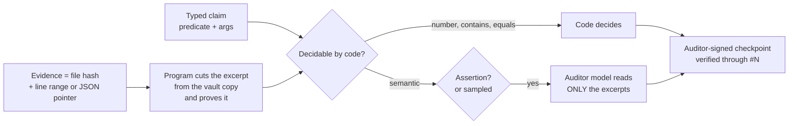

<div align="center">

# eilikrineia

**Un registro pubblico di impegni tra una persona e gli agenti di IA che lavorano per lei.**

[](https://doi.org/10.5281/zenodo.23752630)
[](LICENSE)
[](LICENSES/CC-BY-4.0.txt)
[](https://www.python.org/)
[-brightgreen.svg)](tests)
[](eilikrineia.py)

[English](README.md) · [Português](README.pt-BR.md) · [Español](README.es.md) · [Italiano](README.it.md) · [עברית](README.he.md)

</div>

> [!NOTE]
> Traduzione di [`README.md`](README.md) al commit `bc039be`. In caso di discrepanza, prevale il testo inglese.

> [!IMPORTANT]
> Un agente che dice "fatto", "testato" o "funziona" registra prima qui quella frase, con le prove. Ciò che il codice
> può verificare è verificato dal codice. Ciò che non può verificare lo legge un modello di un altro fornitore, che
> vede solo brevi estratti tagliati e provati dal programma, mai file interi. Il proprietario firma la radice, ogni
> cambio di chiave e ogni modifica al codice dell'auditor. Nulla viene modificato; cambiare posizione è una correzione
> visibile.

> [!WARNING]
> Questi meccanismi reggono solo finché l'agente non può raggiungere la chiave del proprietario, l'account dell'auditor
> o il file del testimone (vedi [Cosa è garantito e cosa no](#cosa-è-garantito-e-cosa-no)). La versione 1.0.0 ha un
> difetto nella radice di fiducia: non usare il suo verificatore né il suo job dell'auditor
> ([`.github/SECURITY.md`](.github/SECURITY.md)); usa la 1.0.1 o successive.

## La parola

**εἰλικρίνεια** (*eilikríneia*) è la parola greca per sincerità, purezza d'intenzione, ciò che non ha mescolanza. I
lessici tradizionalmente la leggono come **εἵλη** (*heílē*, il raggio del sole) + **κρίνω** (*krínō*, giudicare):
*messo alla prova alla luce del sole e trovato senza difetto*. La derivazione è probabile, non accertata; Trench legge
la parola meno come "trasparente" che come **setacciato, purgato, non mescolato**. Questo progetto conserva entrambe le
immagini, e con esse l'incertezza: la luce è l'esposizione pubblica; il setaccio separa ciò che è sostenuto da ciò che
non lo è.

C'è una storia famosa secondo cui il latino *sincerus* significherebbe *sine cera*, "senza cera", dai vasai che
nascondevano le crepe con la cera. È un'etimologia popolare che i dizionari respingono. La raccontiamo di proposito: un
registro della sincerità che si aprisse con un'etimologia bella e falsa sarebbe la sua stessa prima violazione.

Il *Fedone* di Platone (65e–66a) descrive la ricerca della verità "con il pensiero puro, esso stesso per sé stesso"
(*αὐτῇ καθ᾽ αὑτὴν εἰλικρινεῖ τῇ διανοίᾳ*); Paolo usa *eilikríneia* per una condotta che può essere mostrata ed esaminata
(2 Corinzi 1:12; 2:17). La luce che espone e l'esame senza mescolanza diventano meccanismo:

| Idea | Meccanismo |
|---|---|
| Esaminato alla luce del sole | Repository pubblico e marcature temporali su Bitcoin: chiunque verifica, senza chiedere |
| Senza mescolanza | SHA-256: cambiare una virgola cambia l'intero hash |
| Ciò che è stato detto non può essere scambiato | Catena: ogni voce porta l'hash della precedente |
| Cambiare idea apertamente | Una correzione è una nuova voce che punta alla vecchia, che resta |
| Il giudice non è chi afferma | Un auditor di un altro fornitore, in un altro account del sistema operativo, firma il verdetto |
| Purezza senza esposizione | Commitment con salt: l'hash è pubblico, il testo resta privato finché non viene rivelato |

## Cosa apporta

1. **Fiducia radicata nel proprietario.** La prima voce è la genesi del proprietario, firmata con una chiave protetta
   da passphrase. La lista delle chiavi e il codice dell'auditor cambiano solo con una voce firmata dal proprietario;
   il verificatore respinge qualsiasi altra cosa.
2. **Un audit che non legge tutto.** Le affermazioni sono tipizzate. Conteggi, corrispondenze e valori sono decisi dal
   codice. Il modello auditor legge solo estratti di al massimo 2.000 caratteri, tagliati da copie immutabili nel vault
   con una prova di posizione e di hash; i file grandi sono allegati per hash e mai inviati a un modello. Le asserzioni
   rivolte al proprietario sono sempre sottoposte ad audit; le misure automatiche sono campionate con un seed preso da
   un head successivo. Ogni esecuzione dell'auditor firma un checkpoint che porta tutti i suoi verdetti, sottopone ad
   audit solo ciò che è venuto dopo il precedente, e un registro inattivo non aggiunge nulla.
3. **Nessuna riscrittura silenziosa.** Un testimone nell'account separato dell'auditor registra l'hash di ogni voce
   ogni volta che gira il job dell'auditor (ogni ora, e non mentre la macchina è in sospensione); una voce già vista che
   cambia o sparisce solleva un allarme firmato. La storia pubblicata è
   protetta dalla protezione dei rami del remote, da Software Heritage e da OpenTimestamps.



## Avvio rapido

Verifica il registro pubblico (nessun dato privato, nessuna chiave necessaria; Python 3.11+ e OpenSSH 8.9+):

```bash
git clone https://github.com/ulissesflores/eilikrineia
cd eilikrineia
python3 eilikrineia.py verify
```

Output atteso (i conteggi crescono man mano che cresce il registro):

```text
{
  "ok": true,
  "entries": <N>,
  "head": "<64 hex>",
  "problems": [],
  "trust_root": "owner genesis"
}
```

Esegui i test:

```bash
python3 -m unittest discover -s tests -v
```

Avvia un tuo registro:

```bash
python3 eilikrineia.py --root my-ledger init                          # agent and auditor keys
ssh-keygen -t ed25519 -f my-ledger/private/keys/owner                 # YOUR key, with a passphrase
python3 eilikrineia.py --root my-ledger init                          # publishes your public key
python3 eilikrineia.py --root my-ledger genesis                       # you sign the root
python3 eilikrineia.py --root my-ledger record --role agent --type opinion --text "First note."
```

Osservalo e sottoponilo ad audit. Entrambi girano dall'account del sistema operativo proprio dell'auditor (vedi
[`scripts/`](scripts)); il file del testimone deve essere scrivibile solo da quell'account, perché il codice non può
imporre chi lo scrive:

```bash
# witness: remember every entry hash; an entry already seen that changed or vanished becomes a signed alarm
EILIKRINEIA_WITNESS=/path/only/the/auditor/writes/witness.json python3 eilikrineia.py --root my-ledger witness

# audit: code decides number/contains/equals claims; a model from another vendor reads only the excerpts of
# semantic ones, and one signed checkpoint carries every verdict of the run
python3 eilikrineia.py --root my-ledger audit --auditor grok          # or --auditor codex
```

Vedi [`PROTOCOL.md`](PROTOCOL.md) per ruoli, tipi, affermazioni e le regole che un agente segue.

## Cosa è garantito e cosa no

> [!CAUTION]
> **Confine di fiducia.** Tutto ciò che segue presuppone che l'agente non possa raggiungere la chiave privata o la
> passphrase del proprietario, l'account del sistema operativo dell'auditor, o il file del testimone. Un agente che può
> diventare root sulla macchina (per esempio, tramite una password di amministratore conservata dove il suo account può
> leggerla) può vanificare ogni punto. Esegui gli agenti come utente standard senza diritti di amministratore, oppure
> leggi il registro come una contabilità tenuta da un agente cooperativo.
> [Il Protocollo 2](PROTOCOL.md#protocol-2-draft-not-implemented) è progettato per una macchina dell'agente ostile; non
> è implementato.

**Verificato dal codice, entro quel confine.** I test ([`tests/`](tests)) esercitano ogni controllo su una sola
macchina e un solo account; nessuno attraversa il confine tra account.
- Ogni voce pubblicata è collegata a quella precedente: cambiarne o rimuoverne una rompe ogni hash successivo.
- Quale chiave ha firmato ogni voce, rispetto alla lista di chiavi che il proprietario aveva firmato quando la voce è
  stata scritta.
- La lista di chiavi e il codice fissato dell'auditor sono quelli che il proprietario ha firmato per ultimi.
- Ogni estratto letto da un auditor è quello registrato, tagliato dal file di cui era stato registrato l'hash.
- Una voce già vista dal testimone che cambia o sparisce solleva un allarme firmato.

**Non garantito:**
- che un'affermazione sia vera. È tracciabile, contestabile e costosa da sostenere se falsa;
- che le prove provengano dall'esecuzione di qualcosa: una voce `measured` prova ciò che dice un file, e il file
  potrebbe averlo scritto l'agente;
- quando una voce è stata scritta: `time` è dichiarato da chi scrive, e OpenTimestamps dà solo un limite superiore,
  una volta che viene marcato temporalmente un head successivo;
- quale modello ha prodotto una frase: una firma prova una chiave, non una mente;
- ciò che non è mai stato registrato. L'omissione non ha alcun blocco meccanico; il protocollo la considera un
  fallimento;
- voci riscritte tra due esecuzioni del testimone: l'intervallo arriva fino a un'ora, di più mentre la macchina è in
  sospensione.

**Congelati, non rieseguibili:** i registri in [`history/`](history). `v0` (solo chiavi dell'agente) e `v1` (prima
genesi del proprietario) sono stati registrati in portoghese con lo schema di allora; i nomi dei loro campi fanno parte
dei loro hash e restano com'erano. Verificali con lo script congelato:

```bash
python3 history/eilikrineia_v1.py --raiz history/v1 verificar
python3 history/eilikrineia_v1.py --raiz history/v0 verificar
```

## Integrità

La catena è la propria provenienza: non c'è un secondo sigillo. `python3 eilikrineia.py verify` ricalcola ogni hash,
collegamento e firma a partire dai file pubblici. Ogni pubblicazione marca temporalmente l'head con
[OpenTimestamps](https://opentimestamps.org) (`stamps/*.ots`, aggiornati una volta confermati in un blocco Bitcoin), e
il repository è archiviato da [Software Heritage](https://archive.softwareheritage.org).

## Struttura

```text
eilikrineia.py      the whole tool: record, verify, audit, witness, genesis, rotate, stamp, publish
PROTOCOL.md         rules any agent follows to write here
chain/              one public entry per file: hashes, links, signatures
keys/               allowed_signers: the public keys of owner, agent and auditor
stamps/             OpenTimestamps proofs of the head
history/            earlier ledgers (v0, v1) and the frozen script that verifies them
scripts/            auditor job and macOS installer (separate account, pinned code, deploy key)
tests/              one test per guarantee above
private/            never published: texts, salts, gzip evidence vault, private keys, audit replies
```

## Autore

**Carlos Ulisses Flores** — Codex Hash Research Laboratory

[](https://orcid.org/0000-0002-6034-7765)
[](https://ulissesflores.com)
[](http://lattes.cnpq.br/6905246706890561)

## Citazione

Ogni release è archiviata su Zenodo con il proprio DOI. Il concept DOI [10.5281/zenodo.23752630](https://doi.org/10.5281/zenodo.23752630) risolve sempre all'ultima versione; la versione 1.0.1 è [10.5281/zenodo.23820676](https://doi.org/10.5281/zenodo.23820676) e la versione 1.0.0 è [10.5281/zenodo.23752631](https://doi.org/10.5281/zenodo.23752631). Cita con [`CITATION.cff`](CITATION.cff) oppure:

```bibtex
@software{flores2026eilikrineia,
  author = {Flores, Carlos Ulisses},
  orcid  = {https://orcid.org/0000-0002-6034-7765},
  title  = {eilikrineia: a public commitment ledger between a person and the AI agents working for them},
  year   = {2026},
  version = {1.0.1},
  doi    = {10.5281/zenodo.23752630},
  url    = {https://github.com/ulissesflores/eilikrineia}
}
```

## Licenza

Doppia licenza: codice sorgente sotto **Apache-2.0** ([`LICENSE`](LICENSE)); documentazione sotto **CC BY 4.0**
([`LICENSES/CC-BY-4.0.txt`](LICENSES/CC-BY-4.0.txt)). Vedi [`NOTICE`](NOTICE).

## Riferimenti di ancoraggio

- Lessici su εἰλικρίνεια / εἰλικρινής: [Bible Hub 1505](https://biblehub.com/greek/1505.htm),
  [Bible Hub 1506](https://biblehub.com/greek/1506.htm). R. C. Trench, *Synonyms of the New Testament*, su
  εἰλικρινής: [testo](https://modernliteralversion.org/bibles/bs2/G5625up/Trench-85.htm).
- *Sine cera* come etimologia popolare: [Etymonline](https://www.etymonline.com/word/sincere),
  [Grammarphobia](https://grammarphobia.com/blog/2012/03/sincere.html).
- Platone, *Fedone*, testo greco e traduzione di Fowler: [Perseus](https://cts.perseids.org/read/greekLit/tlg0059/tlg004/perseus-eng2/65-66).
- OpenTimestamps: [opentimestamps.org](https://opentimestamps.org/).
