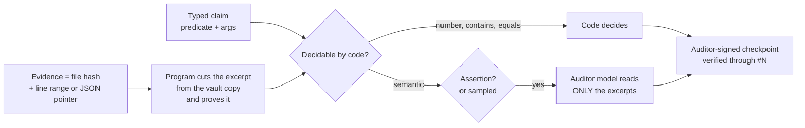

<div align="center">

# eilikrineia

**A public commitment ledger between a person and the AI agents working for them.**

[](https://doi.org/10.5281/zenodo.23752630)
[](LICENSE)
[](LICENSES/CC-BY-4.0.txt)
[](https://www.python.org/)
[-brightgreen.svg)](tests)
[](eilikrineia.py)

</div>

> [!IMPORTANT]
> An agent that says "done", "tested" or "it works" commits that sentence here first, with evidence. What code can
> check is checked by code. What it cannot is read by a model from another vendor, which sees only short excerpts the
> program cut and proved, never whole files. The owner signs the root, every key change and every change to the
> auditor's code. Nothing is edited; changing position is a visible correction.

> [!WARNING]
> These mechanisms hold only while the agent cannot reach the owner's key, the auditor's account or the witness file
> (see [What is and isn't guaranteed](#what-is-and-isnt-guaranteed)). Version 1.0.0 has a trust-root defect: do not
> use its verifier or its auditor job ([`.github/SECURITY.md`](.github/SECURITY.md)).

## The word

**εἰλικρίνεια** (*eilikríneia*) is the Greek word for sincerity, purity of intent, what has no admixture. Lexicons
traditionally read it as **εἵλη** (*heílē*, the sun's ray) + **κρίνω** (*krínō*, to judge): *tested against the light
of the sun and found without flaw*. The derivation is probable, not settled; Trench reads the word less as
"transparent" than as **sifted, purged, unmixed**. This project keeps both images, and the uncertainty with them:
the light is public exposure; the sieve separates what is supported from what is not.

There is a famous story that Latin *sincerus* means *sine cera*, "without wax", from potters who hid cracks with wax.
It is a folk etymology that dictionaries reject. We tell it on purpose: a ledger of sincerity that opened with a
pretty, false etymology would be its own first violation.

Plato's *Phaedo* (65e–66a) describes seeking truth "with pure thought, itself by itself"
(*αὐτῇ καθ᾽ αὑτὴν εἰλικρινεῖ τῇ διανοίᾳ*); Paul uses *eilikríneia* for conduct that can be shown and examined
(2 Corinthians 1:12; 2:17). The light that exposes and the examination without admixture become mechanism:

| Idea | Mechanism |
|---|---|
| Examined in the light of the sun | Public repository and Bitcoin timestamps: anyone verifies, without asking |
| Without admixture | SHA-256: changing one comma changes the whole hash |
| What was said cannot be swapped | Chain: each entry carries the previous hash |
| Changing one's mind in the open | A correction is a new entry pointing at the old one, which stays |
| The judge is not the one who asserts | An auditor from another vendor, in another OS account, signs the verdict |
| Purity without exposure | Salted commitment: the hash is public, the text stays private until revealed |

## What it contributes

1. **Owner-rooted trust.** The first entry is the owner's genesis, signed with a passphrase-protected key. The key
   list and the auditor's code change only with an owner-signed entry; the verifier rejects anything else.
2. **Audit that does not read everything.** Claims are typed. Counts, matches and values are decided by code. The
   auditor model reads only excerpts of at most 2,000 characters, cut from immutable vault copies with a proof of
   position and hash; large files are attached by hash and never sent to a model. Assertions to the owner are always
   audited; automated measurements are sampled with a seed taken from a later head. Each auditor run signs one
   checkpoint that carries all its verdicts, audits only what came after the previous one, and an idle ledger adds
   nothing.
3. **No silent rewrite.** A witness in the auditor's separate account records every entry hash each time the
   auditor's job runs (hourly, and not while the machine sleeps); an entry already seen that changes or vanishes
   raises a signed alarm. Published history is
   protected by the remote's branch protection, Software Heritage and OpenTimestamps.



## Quick start

Verify the public ledger (no private data, no keys needed; Python 3.11+ and OpenSSH 8.9+):

```bash
git clone https://github.com/ulissesflores/eilikrineia
cd eilikrineia
python3 eilikrineia.py verify
```

Expected output (counts grow as the ledger grows):

```text
{
  "ok": true,
  "entries": <N>,
  "head": "<64 hex>",
  "problems": [],
  "trust_root": "owner genesis"
}
```

Run the tests:

```bash
python3 -m unittest discover -s tests -v
```

Start your own ledger:

```bash
python3 eilikrineia.py --root my-ledger init                          # agent and auditor keys
ssh-keygen -t ed25519 -f my-ledger/private/keys/owner                 # YOUR key, with a passphrase
python3 eilikrineia.py --root my-ledger init                          # publishes your public key
python3 eilikrineia.py --root my-ledger genesis                       # you sign the root
python3 eilikrineia.py --root my-ledger record --role agent --type opinion --text "First note."
```

Watch and audit it. Both run from the auditor's own OS account (see [`scripts/`](scripts)); the witness file must
be writable by that account only, because the code cannot enforce who writes it:

```bash
# witness: remember every entry hash; an entry already seen that changed or vanished becomes a signed alarm
EILIKRINEIA_WITNESS=/path/only/the/auditor/writes/witness.json python3 eilikrineia.py --root my-ledger witness

# audit: code decides number/contains/equals claims; a model from another vendor reads only the excerpts of
# semantic ones, and one signed checkpoint carries every verdict of the run
python3 eilikrineia.py --root my-ledger audit --auditor grok          # or --auditor codex
```

See [`PROTOCOL.md`](PROTOCOL.md) for roles, types, claims and the rules an agent follows.

## What is and isn't guaranteed

> [!CAUTION]
> **Trust boundary.** Everything below assumes the agent cannot reach the owner's private key or passphrase, the
> auditor's OS account, or the witness file. An agent that can become root on the machine (for example, through an
> administrator password stored where its account can read it) can defeat every item. Run agents as a standard
> user without administrator rights, or read the ledger as bookkeeping kept by a cooperative agent.
> [Protocol 2](PROTOCOL.md#protocol-2-draft-not-implemented) is designed for a hostile agent machine; it is not
> implemented.

**Checked by code, inside that boundary.** The tests ([`tests/`](tests)) exercise each check on one machine and one
account; none crosses the boundary between accounts.
- Every published entry is linked to the one before it: changing or removing one breaks every later hash.
- Which key signed each entry, against the key list the owner had signed when the entry was written.
- The key list and the auditor's pinned code are the ones the owner last signed.
- Every excerpt an auditor read is the one recorded, cut from the file whose hash was committed.
- An entry already witnessed that changes or vanishes raises a signed alarm.

**Not guaranteed:**
- that a statement is true. It is traceable, contestable and costly to sustain if false;
- that evidence came from running anything: a `measured` entry proves what a file says, and the agent may have
  written the file;
- when an entry was written: `time` is declared by the writer, and OpenTimestamps gives only an upper bound, once a
  later head is stamped;
- which model produced a sentence: a signature proves a key, not a mind;
- what was never recorded. Omission has no mechanical lock; the protocol makes it a failure;
- entries rewritten between two runs of the witness: the gap is up to an hour, longer while the machine sleeps.

**Frozen, not re-runnable:** the ledgers in [`history/`](history). `v0` (agent-only keys) and `v1` (first owner
genesis) were recorded in Portuguese with the schema of that time; their field names are part of their hashes and
stay as they were. Verify them with the frozen script:

```bash
python3 history/eilikrineia_v1.py --raiz history/v1 verificar
python3 history/eilikrineia_v1.py --raiz history/v0 verificar
```

## Integrity

The chain is its own provenance: there is no second seal. `python3 eilikrineia.py verify` recomputes every hash,
link and signature from the public files. Each publication timestamps the head with
[OpenTimestamps](https://opentimestamps.org) (`stamps/*.ots`, upgraded once confirmed in a Bitcoin block), and the
repository is archived by [Software Heritage](https://archive.softwareheritage.org).

## Layout

```text
eilikrineia.py      the whole tool: record, verify, audit, witness, genesis, rotate, stamp, publish
PROTOCOL.md         rules any agent follows to write here
chain/              one public entry per file: hashes, links, signatures
keys/               allowed_signers: the public keys of owner, agent and auditor
stamps/             OpenTimestamps proofs of the head
history/            earlier ledgers (v0, v1) and the frozen script that verifies them
scripts/            auditor job and macOS installer (separate account, pinned code, deploy key)
tests/              one test per guarantee above
private/            never published: texts, salts, gzip evidence vault, private keys, audit replies
```

## Author

**Carlos Ulisses Flores** — Codex Hash Research Laboratory

[](https://orcid.org/0000-0002-6034-7765)
[](https://ulissesflores.com)
[](http://lattes.cnpq.br/6905246706890561)

## Citation

Each release is archived on Zenodo with its own DOI. The concept DOI [10.5281/zenodo.23752630](https://doi.org/10.5281/zenodo.23752630) always resolves to the latest version; version 1.0.0 is [10.5281/zenodo.23752631](https://doi.org/10.5281/zenodo.23752631). Cite with [`CITATION.cff`](CITATION.cff) or:

```bibtex
@software{flores2026eilikrineia,
  author = {Flores, Carlos Ulisses},
  orcid  = {https://orcid.org/0000-0002-6034-7765},
  title  = {eilikrineia: a public commitment ledger between a person and the AI agents working for them},
  year   = {2026},
  version = {1.0.0},
  doi    = {10.5281/zenodo.23752630},
  url    = {https://github.com/ulissesflores/eilikrineia}
}
```

## License

Dual-licensed: source code under **Apache-2.0** ([`LICENSE`](LICENSE)); documentation under **CC BY 4.0**
([`LICENSES/CC-BY-4.0.txt`](LICENSES/CC-BY-4.0.txt)). See [`NOTICE`](NOTICE).

## Anchor references

- Lexicons on εἰλικρίνεια / εἰλικρινής: [Bible Hub 1505](https://biblehub.com/greek/1505.htm),
  [Bible Hub 1506](https://biblehub.com/greek/1506.htm). R. C. Trench, *Synonyms of the New Testament*, on
  εἰλικρινής: [text](https://modernliteralversion.org/bibles/bs2/G5625up/Trench-85.htm).
- *Sine cera* as folk etymology: [Etymonline](https://www.etymonline.com/word/sincere),
  [Grammarphobia](https://grammarphobia.com/blog/2012/03/sincere.html).
- Plato, *Phaedo*, Greek text and Fowler's translation: [Perseus](https://cts.perseids.org/read/greekLit/tlg0059/tlg004/perseus-eng2/65-66).
- OpenTimestamps: [opentimestamps.org](https://opentimestamps.org/).
