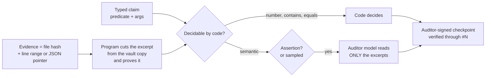

<div align="center">

# eilikrineia

**Um livro-razão público de compromissos entre uma pessoa e os agentes de IA que trabalham para ela.**

[](https://doi.org/10.5281/zenodo.23752630)
[](LICENSE)
[](LICENSES/CC-BY-4.0.txt)
[](https://www.python.org/)
[-brightgreen.svg)](tests)
[](eilikrineia.py)

[English](README.md) · [Português](README.pt-BR.md) · [Español](README.es.md) · [Italiano](README.it.md) · [עברית](README.he.md)

</div>

> [!NOTE]
> Tradução de [`README.md`](README.md) no commit `bc039be`. Em caso de divergência, vale o texto em inglês.

> [!IMPORTANT]
> Um agente que diz "pronto", "testado" ou "funciona" se compromete primeiro aqui com essa frase, com evidência. O que
> o código consegue checar é checado por código. O que ele não consegue é lido por um modelo de outro fornecedor, que
> vê só trechos curtos que o programa recortou e provou, nunca arquivos inteiros. O dono assina a raiz, cada troca de
> chave e cada mudança no código do auditor. Nada é editado; mudar de posição é uma correção visível.

> [!WARNING]
> Esses mecanismos só valem enquanto o agente não consegue alcançar a chave do dono, a conta do auditor nem o arquivo
> da testemunha (veja [O que é e o que não é garantido](#o-que-é-e-o-que-não-é-garantido)). A versão 1.0.0 tem um
> defeito na raiz de confiança: não use o verificador nem a tarefa agendada do auditor dessa versão
> ([`.github/SECURITY.md`](.github/SECURITY.md)); use a 1.0.1 ou posterior.

## A palavra

**εἰλικρίνεια** (*eilikríneia*) é a palavra grega para sinceridade, pureza de intenção, o que não tem mistura. Os
léxicos tradicionalmente a leem como **εἵλη** (*heílē*, o raio de sol) + **κρίνω** (*krínō*, julgar): *provado contra
a luz do sol e achado sem defeito*. A derivação é provável, não está assentada; Trench lê a palavra menos como
"transparente" do que como **peneirado, purificado, sem mistura**. Este projeto guarda as duas imagens, e a incerteza
junto com elas: a luz é a exposição pública; a peneira separa o que tem sustentação do que não tem.

Existe uma história famosa de que o latim *sincerus* significa *sine cera*, "sem cera", por causa de oleiros que
escondiam rachaduras com cera. É uma etimologia popular que os dicionários rejeitam. Nós a contamos de propósito: um
livro-razão da sinceridade que abrisse com uma etimologia bonita e falsa seria a sua própria primeira violação.

O *Fédon* de Platão (65e–66a) descreve buscar a verdade "com o pensamento puro, ele mesmo por si mesmo"
(*αὐτῇ καθ᾽ αὑτὴν εἰλικρινεῖ τῇ διανοίᾳ*); Paulo usa *eilikríneia* para a conduta que pode ser mostrada e examinada
(2 Coríntios 1:12; 2:17). A luz que expõe e o exame sem mistura viram mecanismo:

| Ideia | Mecanismo |
|---|---|
| Examinado à luz do sol | Repositório público e carimbos de tempo no Bitcoin: qualquer pessoa verifica, sem pedir |
| Sem mistura | SHA-256: mudar uma vírgula muda o hash inteiro |
| O que foi dito não pode ser trocado | Cadeia: cada entrada carrega o hash anterior |
| Mudar de ideia às claras | Uma correção é uma nova entrada que aponta para a antiga, que permanece |
| O juiz não é quem afirma | Um auditor de outro fornecedor, em outra conta do sistema operacional, assina o veredito |
| Pureza sem exposição | Compromisso com sal: o hash é público, o texto fica privado até ser revelado |

## O que ele contribui

1. **Confiança enraizada no dono.** A primeira entrada é a gênese do dono, assinada com uma chave protegida por
   frase-senha. A lista de chaves e o código do auditor só mudam com uma entrada assinada pelo dono; o verificador
   rejeita qualquer outra coisa.
2. **Auditoria que não lê tudo.** As alegações são tipadas. Contagens, correspondências e valores são decididos por
   código. O modelo auditor lê só trechos de no máximo 2.000 caracteres, recortados de cópias imutáveis do cofre com
   uma prova de posição e de hash; arquivos grandes são anexados por hash e nunca enviados a um modelo. Afirmações
   feitas ao dono são sempre auditadas; medições automáticas são amostradas com uma semente tirada de um head
   posterior. Cada execução do auditor assina um checkpoint que carrega todos os seus vereditos, audita só o que veio
   depois do checkpoint anterior, e um livro-razão ocioso não acrescenta nada.
3. **Nenhuma reescrita silenciosa.** Uma testemunha na conta separada do auditor registra o hash de cada entrada toda
   vez que a tarefa agendada do auditor roda (de hora em hora, e não enquanto a máquina dorme); uma entrada já vista
   que mude ou desapareça dispara um alarme assinado. O histórico publicado é
   protegido pela proteção de branch do remoto, pelo Software Heritage e pelo OpenTimestamps.



## Início rápido

Verifique o livro-razão público (sem dados privados, sem precisar de chaves; Python 3.11+ e OpenSSH 8.9+):

```bash
git clone https://github.com/ulissesflores/eilikrineia
cd eilikrineia
python3 eilikrineia.py verify
```

Saída esperada (as contagens crescem conforme o livro-razão cresce):

```text
{
  "ok": true,
  "entries": <N>,
  "head": "<64 hex>",
  "problems": [],
  "trust_root": "owner genesis"
}
```

Rode os testes:

```bash
python3 -m unittest discover -s tests -v
```

Comece o seu próprio livro-razão:

```bash
python3 eilikrineia.py --root my-ledger init                          # agent and auditor keys
ssh-keygen -t ed25519 -f my-ledger/private/keys/owner                 # YOUR key, with a passphrase
python3 eilikrineia.py --root my-ledger init                          # publishes your public key
python3 eilikrineia.py --root my-ledger genesis                       # you sign the root
python3 eilikrineia.py --root my-ledger record --role agent --type opinion --text "First note."
```

Vigie e audite o livro-razão. Os dois comandos rodam a partir da conta do sistema operacional do próprio auditor (veja
[`scripts/`](scripts)); o arquivo da testemunha precisa ser gravável só por essa conta, porque o código não consegue
impor quem escreve nele:

```bash
# witness: remember every entry hash; an entry already seen that changed or vanished becomes a signed alarm
EILIKRINEIA_WITNESS=/path/only/the/auditor/writes/witness.json python3 eilikrineia.py --root my-ledger witness

# audit: code decides number/contains/equals claims; a model from another vendor reads only the excerpts of
# semantic ones, and one signed checkpoint carries every verdict of the run
python3 eilikrineia.py --root my-ledger audit --auditor grok          # or --auditor codex
```

Veja [`PROTOCOL.md`](PROTOCOL.md) para os papéis, os tipos, as alegações e as regras que um agente segue.

## O que é e o que não é garantido

> [!CAUTION]
> **Fronteira de confiança.** Tudo o que vem abaixo pressupõe que o agente não consegue alcançar a chave privada nem a
> frase-senha do dono, a conta do sistema operacional do auditor nem o arquivo da testemunha. Um agente que consiga
> virar root na máquina (por exemplo, por meio de uma senha de administrador guardada onde a conta dele consegue ler)
> pode derrubar todos os itens. Rode os agentes como usuário padrão, sem direitos de administrador, ou leia o
> livro-razão como uma escrituração mantida por um agente cooperativo.
> O [Protocolo 2](PROTOCOL.md#protocol-2-draft-not-implemented) foi desenhado para uma máquina de agente hostil; ele
> não está implementado.

**Checado por código, dentro dessa fronteira.** Os testes ([`tests/`](tests)) exercitam cada checagem em uma máquina e
uma conta; nenhum deles cruza a fronteira entre contas.
- Toda entrada publicada está ligada à anterior: mudar ou remover uma delas quebra todos os hashes seguintes.
- Qual chave assinou cada entrada, conferida contra a lista de chaves que o dono tinha assinado quando a entrada foi
  escrita.
- A lista de chaves e o código fixado do auditor são os que o dono assinou por último.
- Todo trecho que um auditor leu é o que ficou registrado, recortado do arquivo cujo hash foi registrado como
  compromisso.
- Uma entrada já testemunhada que mude ou desapareça dispara um alarme assinado.

**Não garantido:**
- que uma declaração seja verdadeira. Ela é rastreável, contestável e cara de sustentar se for falsa;
- que a evidência veio de rodar alguma coisa: uma entrada `measured` prova o que um arquivo diz, e o agente pode ter
  escrito o arquivo;
- quando uma entrada foi escrita: `time` é declarado por quem escreve, e o OpenTimestamps dá só um limite superior,
  depois que um head posterior for carimbado;
- qual modelo produziu uma frase: uma assinatura prova uma chave, não uma mente;
- o que nunca foi registrado. A omissão não tem trava mecânica; o protocolo a define como falha;
- entradas reescritas entre duas execuções da testemunha: o intervalo é de até uma hora, e mais longo enquanto a
  máquina dorme.

**Congelados, não reexecutáveis:** os livros-razão em [`history/`](history). `v0` (só chaves de agente) e `v1`
(primeira gênese do dono) foram registrados em português com o schema daquela época; os nomes dos campos fazem parte
dos hashes deles e ficam como estavam. Verifique-os com o script congelado:

```bash
python3 history/eilikrineia_v1.py --raiz history/v1 verificar
python3 history/eilikrineia_v1.py --raiz history/v0 verificar
```

## Integridade

A cadeia é a sua própria proveniência: não existe um segundo selo. `python3 eilikrineia.py verify` recalcula cada
hash, ligação e assinatura a partir dos arquivos públicos. Cada publicação carimba o head no tempo com
[OpenTimestamps](https://opentimestamps.org) (`stamps/*.ots`, atualizados assim que confirmados num bloco do Bitcoin),
e o repositório é arquivado pelo [Software Heritage](https://archive.softwareheritage.org).

## Estrutura

```text
eilikrineia.py      the whole tool: record, verify, audit, witness, genesis, rotate, stamp, publish
PROTOCOL.md         rules any agent follows to write here
chain/              one public entry per file: hashes, links, signatures
keys/               allowed_signers: the public keys of owner, agent and auditor
stamps/             OpenTimestamps proofs of the head
history/            earlier ledgers (v0, v1) and the frozen script that verifies them
scripts/            auditor job and macOS installer (separate account, pinned code, deploy key)
tests/              one test per guarantee above
private/            never published: texts, salts, gzip evidence vault, private keys, audit replies
```

## Autor

**Carlos Ulisses Flores** — Codex Hash Research Laboratory

[](https://orcid.org/0000-0002-6034-7765)
[](https://ulissesflores.com)
[](http://lattes.cnpq.br/6905246706890561)

## Citação

Cada versão publicada é arquivada no Zenodo com o seu próprio DOI. O DOI de conceito [10.5281/zenodo.23752630](https://doi.org/10.5281/zenodo.23752630) sempre resolve para a versão mais recente; a versão 1.0.1 é [10.5281/zenodo.23820676](https://doi.org/10.5281/zenodo.23820676) e a versão 1.0.0 é [10.5281/zenodo.23752631](https://doi.org/10.5281/zenodo.23752631). Cite com [`CITATION.cff`](CITATION.cff) ou:

```bibtex
@software{flores2026eilikrineia,
  author = {Flores, Carlos Ulisses},
  orcid  = {https://orcid.org/0000-0002-6034-7765},
  title  = {eilikrineia: a public commitment ledger between a person and the AI agents working for them},
  year   = {2026},
  version = {1.0.1},
  doi    = {10.5281/zenodo.23752630},
  url    = {https://github.com/ulissesflores/eilikrineia}
}
```

## Licença

Licença dupla: o código-fonte sob **Apache-2.0** ([`LICENSE`](LICENSE)); a documentação sob **CC BY 4.0**
([`LICENSES/CC-BY-4.0.txt`](LICENSES/CC-BY-4.0.txt)). Veja [`NOTICE`](NOTICE).

## Referências de ancoragem

- Léxicos sobre εἰλικρίνεια / εἰλικρινής: [Bible Hub 1505](https://biblehub.com/greek/1505.htm),
  [Bible Hub 1506](https://biblehub.com/greek/1506.htm). R. C. Trench, *Synonyms of the New Testament*, sobre
  εἰλικρινής: [texto](https://modernliteralversion.org/bibles/bs2/G5625up/Trench-85.htm).
- *Sine cera* como etimologia popular: [Etymonline](https://www.etymonline.com/word/sincere),
  [Grammarphobia](https://grammarphobia.com/blog/2012/03/sincere.html).
- Platão, *Fédon*, texto grego e tradução de Fowler: [Perseus](https://cts.perseids.org/read/greekLit/tlg0059/tlg004/perseus-eng2/65-66).
- OpenTimestamps: [opentimestamps.org](https://opentimestamps.org/).
